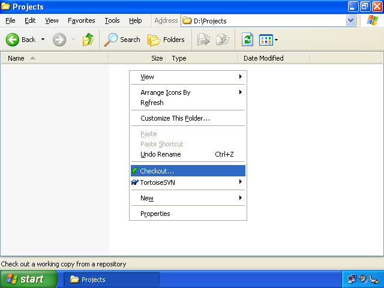
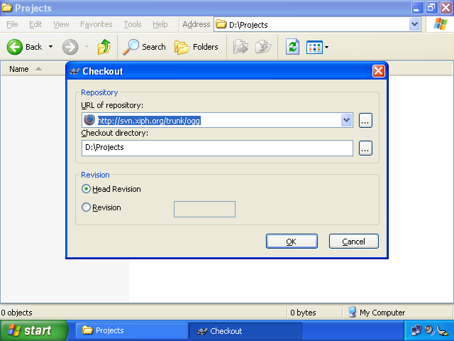
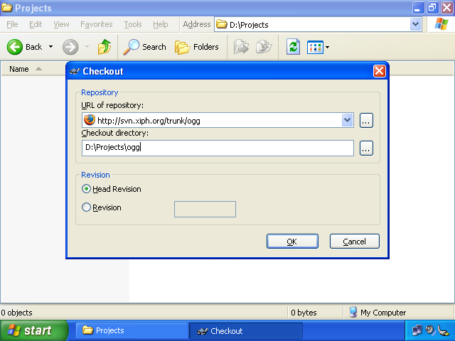
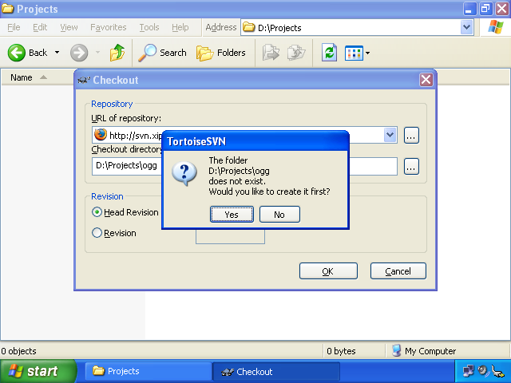
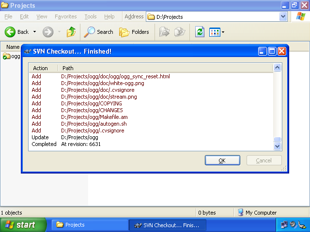

Windows-Specific Notes for Subversion Access
============================================

If you want to use a Subversion client on Windows, there are two clients that we’ve used:
the [official command-line client][svn.exe] and [TortoiseSVN][]. It’s possible to use both
to work on the same checked-out repository and it’s rather nice to have both clients around;
some things are simply easier in one client or the other.

This document assumes you’ve at least glanced at our [generic subversion instructions][generic].

	[svn.exe]:		http://subversion.tigris.org/
	[TortoiseSVN]:	http://tortoisesvn.tigris.org/
	[generic]:		../

## Starting Out with TortoiseSVN

 
[TortoiseSVN][] is a Windows Explorer shell extension that will let you do Subversion
things from within Windows Explorer. Once you have it installed, create a folder where
you can group your checkouts together; we’ll use D:\Projects in these examples.

Inside of D:\Projects, right-click somewhere in the blank space and select the “Checkout...”
option from the menu.

&nbsp;

Now, type in the URL of the section of the repository that you want. Not sure what you want
or where it is? Have a look at <http://svn.xiph.org/> in this Web browser. Unless you want
Icecast-specific things, you’ll probably have the most success in a subdirectory of [/trunk/][].
Since so much of our stuff depends on [Ogg][], we’ll download it.

&nbsp;

Now that you’re reasonably certain of what you want, you need to tell TortoiseSVN where you want
your Ogg checkout to go. TortoiseSVN has already suggested the current folder,
but checking [/trunk/ogg/][] out to the current folder will put a bunch of Ogg
things directly in the current folder rather than keeping them in a nice, tidy subfolder of
D:\Projects. As such, append “\ogg” to the “Checkout Directory” box.

&nbsp;

&nbsp;

…and that’s it. Repeat with <http://svn.xiph.org/trunk/vorbis/> and
<http://svn.xiph.org/trunk/vorbis-tools/> and you’ll have everything you need
to build things like oggenc.exe.

&nbsp;

	[/trunk/]:		http://svn.xiph.org/trunk/
	[/trunk/ogg/]:	http://svn.xiph.org/trunk/ogg/
	[Ogg]:			/ogg/ "Ogg, the container format"
